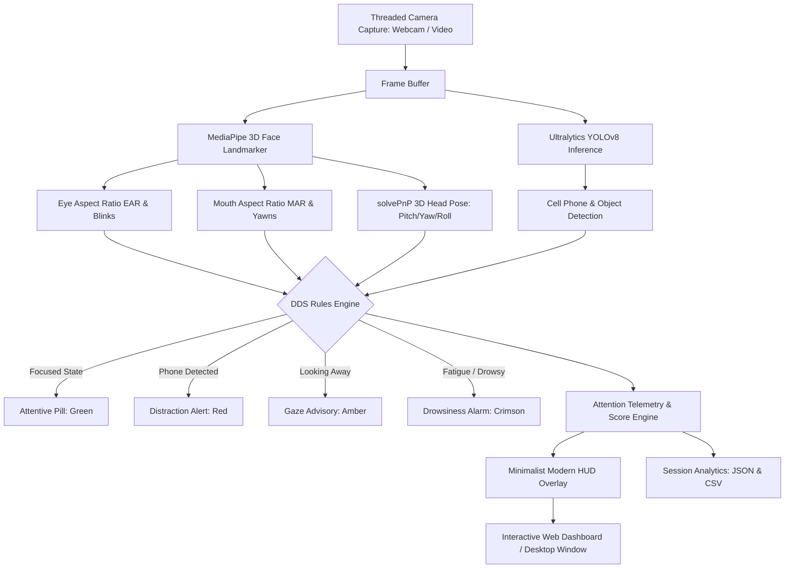

# Distraction Detection System (DDS)


An AI-powered computer vision system designed for real-time human attention, focus, and distraction tracking across diverse real-world environments:
- 🎓 **Study & Online Education:** Track classroom engagement, exam proctoring focus, and prevent phone distractions.
- 💼 **Productivity & Deep Work:** Measure workplace focus duration, screen attention, and reduce digital interruptions.
- 🚗 **Driver & Operator Safety:** Monitor micro-sleeps, prolonged eye closure (EAR), yawning (MAR), looking off-road, and texting while operating vehicles or heavy machinery.

Built with **Python**, **OpenCV**, **Google MediaPipe**, and **Ultralytics YOLOv8**.

---

## Key Detection Capabilities

### 1. Eye-Tracking & Fatigue Analysis (EAR & PERCLOS)
- Computes **Eye Aspect Ratio (EAR)** using 3D Euclidean landmarks from MediaPipe FaceMesh in real time.
- Quantifies **PERCLOS** (Percentage of Eye Closure), the scientific gold standard for physiological drowsiness and fatigue.
- Accurately tracks blinks, blink duration, and flags micro-sleep episodes ($> 1.5\text{s}$).

### 2. Gaze Direction & 3D Head Pose (`cv2.solvePnP`)
- Maps 2D landmarks to an anthropometric 3D facial coordinate model to compute Euler angles (**Pitch, Yaw, Roll**).
- Flags when the user looks away from their primary focus zone (turning head sideways $> 24^\circ$, looking down at lap/phone $> 18^\circ$, or gazing upwards).
- Projects an intuitive 3D gaze vector arrow indicating visual focus in real time.

### 3. External Object & Cell Phone Detection (YOLOv8)
- Employs a high-speed **YOLOv8 nano** model to identify distraction objects.
- Real-time detection of **cell phones**, cups, and bottles with debounced multi-frame persistence checks to prevent false alarms.

### 4. Non-Blocking Audio & Visual Alert Coordinator
- Runs sound synthesis and audio alerts in an asynchronous background worker thread to ensure the video pipeline never drops frames.
- Rate-limited notification cooldowns prevent alarm fatigue.

### 5. Multi-Mode Operation
- **General Focus Mode:** Standard attention tracking for any desk or daily scenario.
- **Study & Work Mode:** Tailored for screen engagement, study focus, and digital distraction reduction.
- **Driver Safety Mode:** Tailored for road alertness, fatigue, and vehicular safety.

---

## System Architecture



---

## Project Structure

```
DSS/
├── config.py                 # Parameters, thresholds, and color palettes
├── camera.py                 # Threaded, asynchronous video capture engine
├── face_mesh_detector.py     # MediaPipe Face Landmarker, EAR, MAR & 3D Head Pose
├── yolo_detector.py          # YOLOv8 object & phone distraction detector
├── alert_system.py           # Multi-threaded non-blocking audio & visual alerts
├── analytics.py              # Telemetry engine, PERCLOS & Attention Score calculator
├── ui_overlay.py             # Minimalist glassmorphic HUD overlay
├── app_web.py                # Modern FastAPI interactive browser dashboard
├── main.py                   # Master desktop application runner
├── synthetic_demo.py         # Multi-phase simulation scenario video generator
├── test_system.py            # Automated unit and integration test suite
├── start_web.bat             # 1-click Web Dashboard launcher
├── start_desktop.bat         # 1-click Desktop application launcher
├── start_demo.bat            # 1-click Scenario simulation demo launcher
├── requirements.txt          # Dependencies specification
├── models/                   # Pretrained weights (face_landmarker.task, yolov8n.pt)
└── session_reports/          # Automatically exported JSON summaries & CSV logs
```

---

## Quick Start & Running

### 1. Launch the Modern Web Dashboard (Recommended)
Double-click `start_web.bat` or run:
```powershell
python app_web.py
```
Then open your browser to **http://127.0.0.1:8000**.
- Features live video streaming with 3D gaze indicators and object brackets.
- Animated SVG Focus Score dial.
- Mode switcher (General, Study, Driving).
- Camera switcher and chronological incident timeline.

### 2. Launch the Desktop Application
Double-click `start_desktop.bat` or run:
```powershell
# Default Camera 0
python main.py --source 0

# Specify Mode (GENERAL, STUDY, or DRIVING)
python main.py --source 0 --mode STUDY
```

### 3. Run the Demonstration Video
```powershell
python main.py --source sample_driver_demo.mp4
```

---

## Keyboard Shortcuts (Desktop & Web)

| Shortcut Key | Action |
|:---:|:---|
| **`TAB`** or **`T`** | **Cycle Detection Mode** (`General` $\to$ `Study` $\to$ `Driving`) |
| **`1`**, **`2`**, **`3`** | **Instant Mode Switch** (`1` = General, `2` = Study & Work, `3` = Driving) |
| **`D`** | Toggle detailed 3D facial mesh wireframe overlay |
| **`M`** | Toggle audio alerts (**Mute / Unmute**) |
| **`R`** | Reset session statistics and attention score |
| **`S`** | Save an instant snapshot to `snapshots/` folder |
| **`Q`** or **`ESC`** | Gracefully quit and save session telemetry report (Desktop) |

---

## Automated Tests

Run the built-in test suite:
```powershell
python test_system.py
```
*(All 6 unit and integration test cases validate end-to-end functionality).*
