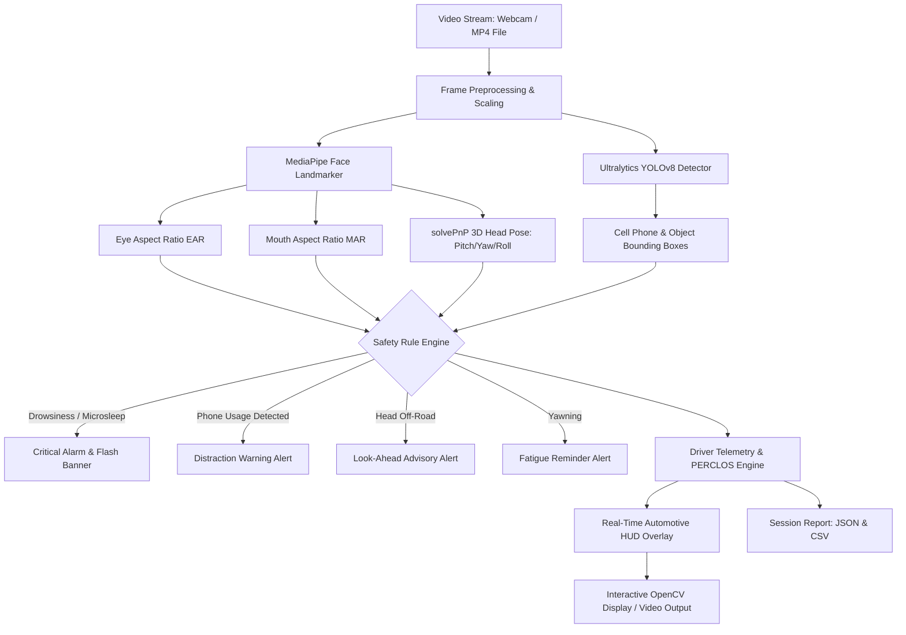

# Real-Time Driver Safety & Distraction Detection System (Prototype)


A high-performance, real-time computer vision system engineered to monitor driver fatigue, microsleeps, head pose gaze distraction, and external object distractions (such as hand-held cell phone usage). Built with **Python**, **OpenCV**, **Google MediaPipe**, and **Ultralytics YOLOv8**.

---

## Key Features & Detection Modules

### 1. Eye-Tracking & Fatigue Monitoring (EAR)
- Computes **Eye Aspect Ratio (EAR)** in real time using 6-point Euclidean landmark formulations from MediaPipe's 468+ 3D facial mesh.
- Detects blinks, blink duration, and micro-sleep episodes (consecutive eye closures exceeding $1.5\text{s}$).
- Calculates **PERCLOS** (Percentage of Eye Closure over time), the NHTSA gold standard metric for driver drowsiness quantification.

### 2. Yawning & Soporific Fatigue Detection (MAR)
- Computes **Mouth Aspect Ratio (MAR)** measuring vertical lip expansion against horizontal mouth width.
- Detects sustained yawning patterns with debounce timers to differentiate speech from fatigue.

### 3. 3D Head Pose & Gaze Vector Estimation
- Employs `cv2.solvePnP` against generic 3D anthropometric facial landmarks to derive rotation vectors (`rvec`) and translation vectors (`tvec`).
- Decomposes rotation matrices into Euler angles:
  - **Pitch**: Nodding off / looking down at the lap/phone ($> 18^\circ$).
  - **Yaw**: Turning head away from the road ($> 25^\circ$).
  - **Roll**: Lateral head tilt.
- Projects 3D gaze directional vector arrows extending from the nose tip to visually indicate driver focus.

### 4. External Distraction Detection (YOLOv8)
- Integrates a lightweight **YOLOv8 nano** model running real-time object detection.
- Specifically flags external distraction vectors:
  - **Cell Phone Usage**: High-priority alert when a phone is identified within driver interaction proximity.
  - **Bottles & Cups**: Flags prolonged drinking or eating while operating the vehicle.

### 5. Multi-Threaded Audio & Visual Alert System
- Asynchronous alert queue executing in a background daemon thread to ensure audio alerts never bottleneck or drop video processing frame rates.
- Progressive alert tiers: Warning tones $\to$ Urgent critical alarms $\to$ Pulsing emergency HUD banners.
- Includes rate-limiting cooldown timers to prevent alarm fatigue.

### 6. Automated Telemetry & Drive Analytics
- Evaluates a dynamic **Driver Safety Score** (0–100 scale) penalized proportionally by safety incidents.
- Automatically exports comprehensive session metrics on exit:
  - `session_reports/report_<timestamp>.json`: Detailed numerical statistics and driver rating grade.
  - `session_reports/incidents_<timestamp>.csv`: Event-by-event timeline logs with exact drive durations.

---

## System Architecture



---

## Directory Structure

```
DSS/
├── config.py                 # Central parameters, thresholds, and colors
├── download_models.py        # Automated model weights downloader
├── face_mesh_detector.py     # MediaPipe Face Landmarker, EAR, MAR & Head Pose
├── yolo_detector.py          # YOLOv8 external object & phone distraction module
├── alert_system.py           # Multi-threaded non-blocking audio & visual alert manager
├── analytics.py              # Telemetry tracker, PERCLOS calculation & report exporter
├── ui_overlay.py             # Automotive Heads-Up Display (HUD) rendering
├── main.py                   # Master application execution pipeline
├── synthetic_demo.py         # Multi-phase synthetic driver video generator
├── test_system.py            # Unit & integration automated test suite
├── requirements.txt          # Python dependencies
├── models/                   # Pretrained weights (face_landmarker.task, yolov8n.pt)
├── session_reports/          # Exported JSON summaries and CSV incident logs
└── snapshots/                # High-resolution HUD screenshots
```

---

## Installation & Setup

1. **Clone or navigate to the repository directory**:
   ```bash
   cd c:\Users\VASISHTA\OneDrive\Desktop\DSS
   ```

2. **Verify Python dependencies**:
   ```bash
   pip install -r requirements.txt
   ```

3. **Ensure pretrained model weights are downloaded**:
   ```bash
   python download_models.py
   ```
   *(Both `models/face_landmarker.task` and `models/yolov8n.pt` will be verified and downloaded automatically).*

---

## Running the System

### 1. Live Webcam Feed
Launch the live camera stream (uses default camera index `0`):
```bash
python main.py --source 0
```

### 2. Demonstration Video File
Run the system against a pre-recorded drive or our generated scenario simulation video:
```bash
python main.py --source sample_driver_demo.mp4
```

### 3. Record Annotated Session Video
To record the full HUD output to a high-definition video file:
```bash
python main.py --source 0 --output output_drive.mp4
```

### 4. Low-Power / Face-Only Mode (Disable YOLOv8)
For constrained hardware environments:
```bash
python main.py --source 0 --no-yolo
```

---

## Keyboard Controls

| Key | Action |
|:---:|:---|
| **`Q`** or **`ESC`** | Quit application gracefully and export session analytics |
| **`M`** | Toggle audio alert mute / unmute |
| **`R`** | Reset session statistics and safety score |
| **`S`** | Capture instantaneous HUD snapshot to `snapshots/` folder |
| **`D`** | Toggle detailed facial mesh wireframe overlay |

---

## Running Automated Tests

Run the built-in unit and integration test suite:
```bash
python test_system.py
```
This validates all model initializations, numerical metric calculations, threading behaviors, and video pipelines.

---

## Key Thresholds Reference (`config.py`)

| Metric | Threshold | Condition | Action |
|:---|:---:|:---|:---|
| **Eye Aspect Ratio (EAR)** | `< 0.21` | Eyes closed $> 1.5\text{s}$ | Critical Drowsiness Alarm |
| **Mouth Aspect Ratio (MAR)** | `> 0.65` | Mouth wide open $> 1.0\text{s}$ | Yawning / Fatigue Alert |
| **Head Yaw** | `> ±25°` | Looking left/right off road | Eyes-Off-Road Warning |
| **Head Pitch** | `> +18°` | Head drooping / looking at lap | Inattention Alert |
| **YOLO Cell Phone** | `Conf ≥ 0.35` | Phone in driver interaction zone | Cell Phone Distraction Alert |
